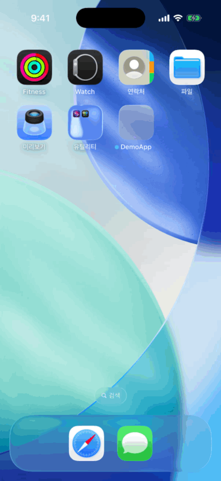
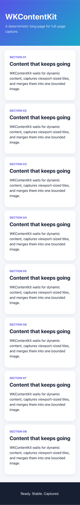

# WKContentKit

[](https://github.com/Dabin22/WKContentKit/actions/workflows/ci.yml)


Policy-based `WKWebView` content stabilization and bounded full-page screenshot capture for iOS.

Use WKContentKit to detect when `WKWebView` content is ready, wait for DOM, fonts, and images to stabilize, or capture a memory-bounded full-page screenshot in Swift.

[한국어](README.ko.md)

## Why

`WKWebView.takeSnapshot` captures only what is rendered at the moment it is called. In practice this means:

- `webView(_:didFinish:)` fires while images, web fonts, and client-side rendering are still in progress, so snapshots miss content.
- Lazy images and infinite lists only load after the user scrolls.
- Long pages cannot be captured in one call, and rendering a whole page into one bitmap has no natural memory limit.

WKContentKit came out of building an iOS app that drew eye-tracking data on top of full web pages. It treats "ready" as an explicit, testable policy instead of a guess, and every capture runs inside a pixel and time budget you control.

<p align="center">
  
</p>

## Requirements

- iOS 15+
- Swift 6
- Swift Package Manager

## Products

- `WKWebViewReadiness`: Wait until a page satisfies an explicit readiness policy.
- `WKWebViewCapture`: Trigger lazy content, capture viewport tiles, and merge them into a bounded `UIImage`.

`WKWebViewCapture` depends on `WKWebViewReadiness`.

## Features

- `WKWebView` readiness detection using document state, DOM mutations, fonts, images, and an optional custom JavaScript condition.
- Full-page and long-page `WKWebView` screenshot capture using viewport tiles and native `UIImage` output.
- Lazy-loaded content discovery, async/await APIs, capture timeout, and configurable pixel limits.
- No third-party dependencies.

## Installation

Add `https://github.com/Dabin22/WKContentKit.git` in Xcode's Package Dependencies UI, select version `0.1.0` using the **Up to Next Minor Version** rule, then select either product.

For a `Package.swift` dependency:

```swift
.package(
    url: "https://github.com/Dabin22/WKContentKit.git",
    .upToNextMinor(from: "0.1.0")
)
```

## Readiness

```swift
import WKWebViewReadiness

try await webView.waitUntilContentIsReady(policy: .balanced)
```

Presets are ordinary values and can be adjusted:

```swift
var policy = ReadinessPolicy.balanced
policy.timeout = 20
policy.images = .all
policy.customJavaScript = "window.appContentReady === true"

try await webView.waitUntilContentIsReady(policy: policy)
```

## Full-page capture

```swift
import WKWebViewCapture

let image = try await webView.captureFullPage()
```

<p align="center">
  <a href="Assets/WKContentKit-full-page.png">
    
  </a>
</p>

For an upload-sized error report, reduce output width before capture and use UIKit's native encoder:

```swift
var options = CaptureOptions.default
options.maximumPixelWidth = 1_440

let image = try await webView.captureFullPage(options: options)
let data = image.jpegData(compressionQuality: 0.8)
```

## How it works

**Readiness** (`waitUntilContentIsReady`) polls a small JavaScript probe every 100 ms. The probe reports `document.readyState`, font loading, pending images, a `MutationObserver` change counter, and document height. The page is ready when the policy's conditions hold and the mutation count and height stay unchanged for `stabilityDuration`. If the timeout passes first, it throws `ReadinessError.timedOut`. The timeout also covers each JavaScript call, so a page whose `evaluateJavaScript` never returns still fails on time instead of hanging.

**Capture** (`captureFullPage`):

1. Records the web view's scroll and interaction state, and disables user interaction.
2. Scrolls through the page once so lazy content loads, waiting for readiness at each step.
3. Computes the output size and **checks the pixel budget before allocating** the bitmap.
4. Scrolls viewport by viewport, snapshots each tile, and draws it into one `CGContext`.
5. Restores the original state in a `defer`, whether capture succeeds, fails, or is cancelled.

## Design notes

- **Main-actor isolation.** All WebKit access is `@MainActor`. Public options and errors are `Sendable` value types, so they can be created on any task.
- **Re-entrancy guard.** Capture suspends many times on the main actor. A second capture on the same web view during those suspensions would fight over the scroll position, so the web view is registered synchronously before the first `await` and a concurrent call fails with `CaptureError.alreadyInProgress`.
- **State re-validation after `await`.** Before each tile, capture checks that the document has not navigated away (`documentChangedDuringCapture`) and that the page height has not changed (`contentChangedDuringCapture`), instead of trusting state read before suspension.
- **Cooperative cancellation.** Loops call `Task.checkCancellation()`, so cancelling the calling task stops capture at the next step.
- **Timeouts that include JavaScript.** `evaluateJavaScript` cannot be cancelled, and a task group waits for every child before it returns. Each probe therefore runs through a cancellation-aware bridge that resumes its continuation exactly once, and races against a timer for the remaining time budget. A hung script ends in `timedOut` instead of a stuck task.
- **Budgets over guarantees.** Readiness is policy satisfaction, not proof that the network is idle. Capture fails fast with a recovery suggestion rather than allocating an unbounded image.

## Errors

| Error | When | What to try |
| --- | --- | --- |
| `CaptureError.imageTooLarge` | Output exceeds `maximumPixelCount` | Lower `maximumPixelWidth`, disable `loadLazyContent`, or raise the limit if memory allows |
| `CaptureError.timedOut` | Capture exceeds `timeout` | Increase the timeout or capture a less dynamic page |
| `CaptureError.contentChangedDuringCapture` | Page height changed mid-capture | Retry after the page stops changing |
| `CaptureError.documentChangedDuringCapture` | Navigation happened mid-capture | Retry after navigation finishes |
| `CaptureError.alreadyInProgress` | Another capture is running on the same web view | Wait for the first capture to finish |
| `ReadinessError.timedOut` | Policy not satisfied before `timeout` | Use a looser preset or add `customJavaScript` |

## Testing

The readiness loop talks to the page through a small internal protocol (`JavaScriptEvaluating`) instead of `WKWebView` directly. Unit tests replace it with a fake that returns scripted probe results, fails, or never answers, so policy, stability, timeout, and error paths are tested without loading a web page.

```sh
xcodebuild test -scheme WKContentKit-Package -destination 'platform=iOS Simulator,name=iPhone 16 Pro'
```

## Memory behavior

Capture is tile-based internally, but the public result is one `UIImage`. The package checks the final pixel count before allocating the bitmap and throws `CaptureError.imageTooLarge` when it exceeds `maximumPixelCount`.

The default capture width is capped at 750 pixels so typical mobile pages can be captured at a practical upload size while the 20-million-pixel memory limit remains in place. Set `maximumPixelWidth` to `nil` for native display resolution.

## Demo app

Open `Examples/DemoApp/DemoApp.xcodeproj`, select an iOS Simulator, and run the `DemoApp` scheme. The app uses the package from the repository root.

## Limitations

- Readiness is policy satisfaction, not proof that every network request has finished.
- Cross-origin iframe contents cannot be inspected for readiness.
- Infinite scroll is bounded by capture timeout and pixel limits.
- Fixed and sticky elements may repeat between captured viewports.
- Capture temporarily scrolls the supplied web view and restores its native state afterward. JavaScript side effects caused by scrolling cannot be undone.
- Capturing a new top-level document during an active capture fails.

## License

WKContentKit is available under the MIT License.

## Versioning

WKContentKit follows [Semantic Versioning](https://semver.org/). Before `1.0.0`, minor releases may contain breaking API changes and patch releases remain backward compatible.
